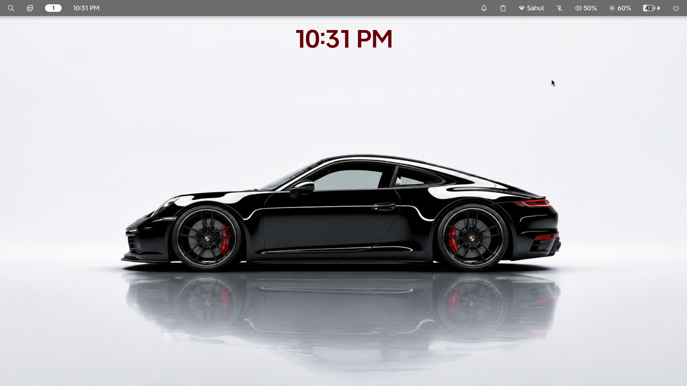
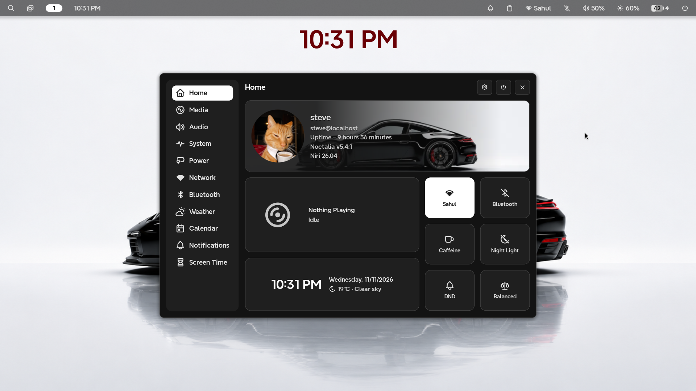
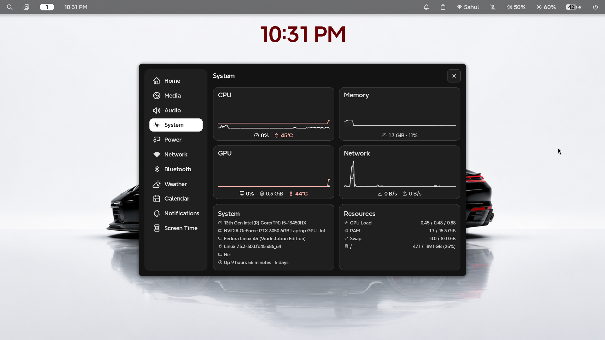
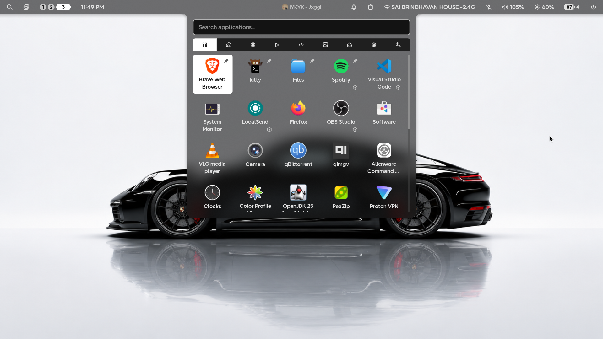
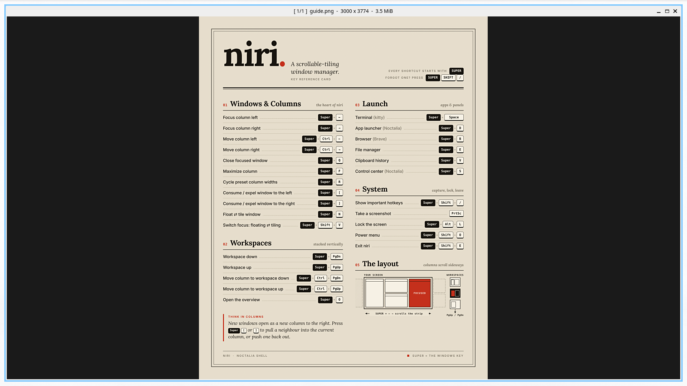
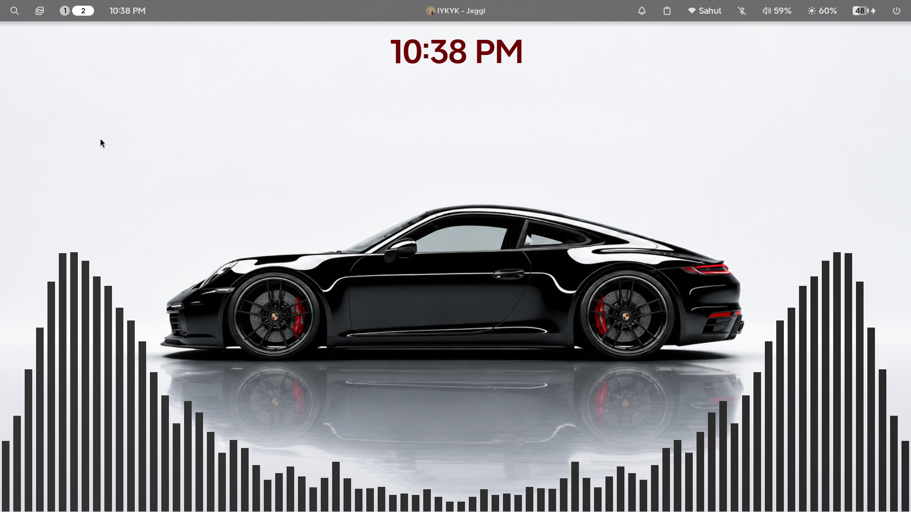

# Fedora Linux — Dotfiles

<p align="center">
  A personal collection of configurations for my Fedora Linux desktop.
  <br>
  Powered by <b>Niri</b> and <b>Noctalia v5</b>.
</p>

<p align="center">
  
  
  
  
</p>

---

## Screenshots

A glimpse into my desktop environment.

<p align="center">
  
  
</p>
<p align="center">
  
  
</p>
<p align="center">
  
  
</p>

---

## Environment

| Component | Details |
|:---|:---|
| Operating System | Fedora Linux |
| Window Manager | [Niri](https://github.com/niri-wm/niri) |
| Desktop Shell | [Noctalia v5](https://github.com/noctalia-dev/noctalia-shell) |
| Display Server | Wayland |
| Terminal Emulator | [Kitty](https://github.com/kovidgoyal/kitty) |
| Visualizer | [CAVA](https://github.com/karlstav/cava) |
| Music Player Daemon | MPD |
| Media Player | MPV |
| GPU | NVIDIA GeForce RTX 3050 |

## Repository Structure

```text
dotfiles/
│
├── cava/           # Audio visualizer configuration
├── dot-local/      # Local user configurations
├── kitty/          # Terminal configuration
├── mpd/            # Music Player Daemon configuration
├── mpv/            # Media player configuration
├── niri/           # Niri window manager configuration
│
├── screenshots/    # Desktop screenshots
│   ├── screenshot1.png
│   ├── screenshot2.png
│   ├── screenshot3.png
│   ├── screenshot4.png
│   ├── screenshot5.png
│   └── screenshot6.png
│
└── readme.md
```


### 3. Apply configurations

Review the repository directories and copy the relevant configurations into their corresponding locations under `~/.config/` and `~/.local/`.

Avoid blindly copying directories if you already have existing configurations.

### 4. Restart your session

Log out and select Niri from your display manager to apply the window manager configuration.

## Dependencies

The following software is used in this setup:

- Fedora Linux
- Niri
- Noctalia v5
- Kitty
- CAVA
- MPD
- MPV

Install the components you need before applying their respective configurations.

## Credits

A few projects that make this setup possible:

- [Niri](https://github.com/niri-wm/niri)
- [Noctalia](https://github.com/noctalia-dev/noctalia-shell)
- [Kitty](https://github.com/kovidgoyal/kitty)
- [CAVA](https://github.com/karlstav/cava)
- [MPD](https://www.musicpd.org/)
- [MPV](https://mpv.io/)

---

<p align="center">
  <i>Built, configured and customized on Fedora Linux.</i>
  <br><br>
  <sub>Feel free to explore, fork and adapt these configurations.</sub>
</p>