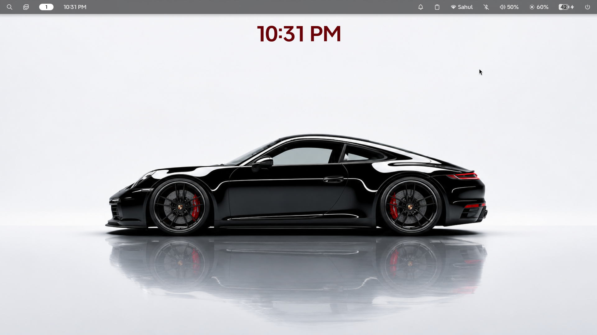
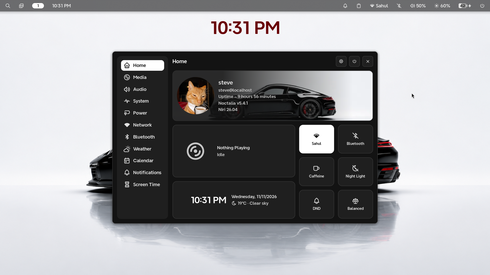
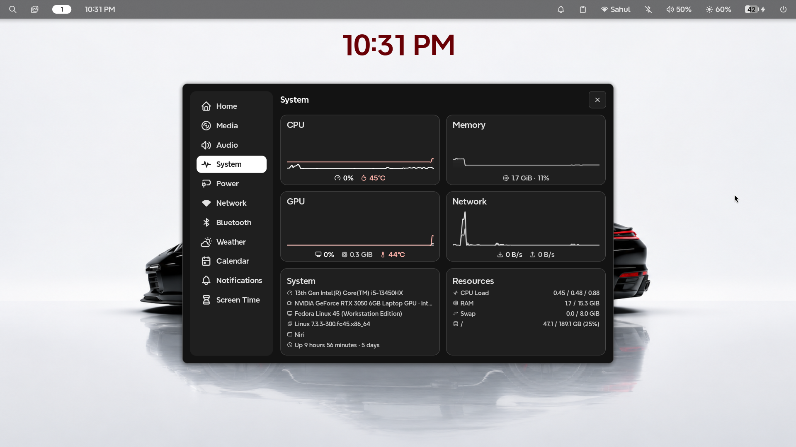
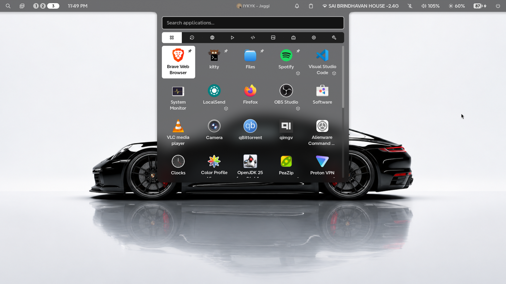
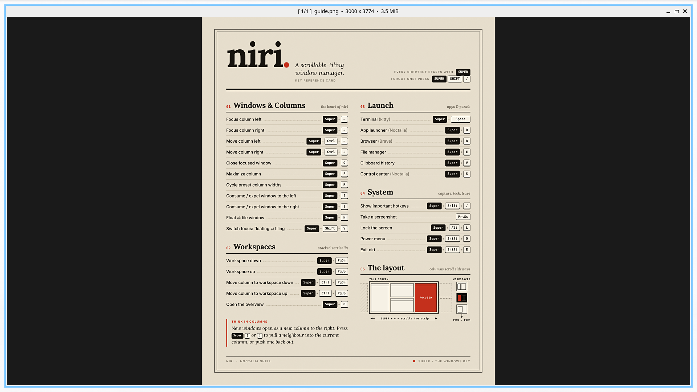
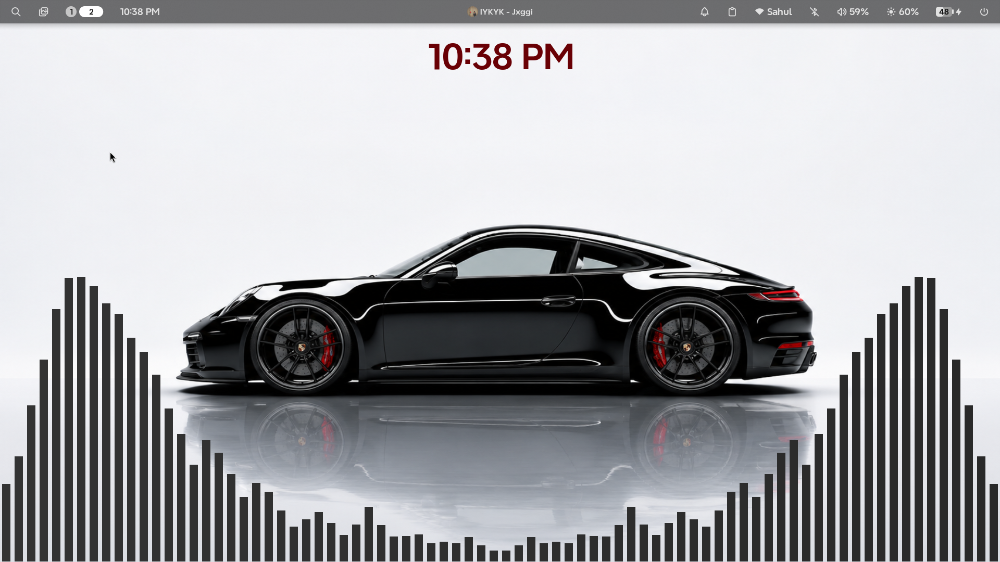

# Fedora Linux — Dotfiles

<p align="center">
  A personal collection of configurations for my Fedora Linux desktop.
  <br>
  Powered by <b>Niri</b> and <b>Noctalia v5</b>.
</p>

<p align="center">
  
  
  
  
</p>

---

## Screenshots

A glimpse into my desktop environment.

<p align="center">
  
  
</p>
<p align="center">
  
  
</p>
<p align="center">
  
  
</p>

---

## Environment

| Component | Details |
|:---|:---|
| Operating System | Fedora Linux |
| Window Manager | [Niri](https://github.com/niri-wm/niri) |
| Desktop Shell | [Noctalia v5](https://github.com/noctalia-dev/noctalia-shell) |
| Display Server | Wayland |
| Terminal Emulator | [Kitty](https://github.com/kovidgoyal/kitty) |
| Visualizer | [CAVA](https://github.com/karlstav/cava) |
| Music Player Daemon | MPD |
| Media Player | [VLC](https://www.videolan.org/vlc/) |
| GPU | NVIDIA GeForce RTX 3050 |

## Repository Structure

```text
dotfiles-backup/
├── install.sh         # Automated installer script
├── README.md
└── dotfiles/
    ├── .config/
    │   ├── cava/      # Audio visualizer configuration & shaders
    │   ├── kitty/     # Terminal configuration
    │   ├── mpd/       # Music Player Daemon configuration
    │   ├── niri/      # Niri window manager modular configuration
    │   ├── noctalia/  # Noctalia shell configuration (settings.toml)
    │   └── screenshots/
    └── .local/
        └── state/
            └── noctalia/ # Noctalia runtime state and settings
```

## Quick Start / Installation

Run the automated installer script:

```bash
git clone https://github.com/sahulhustles/dotfiles-backup.git
cd dotfiles-backup
chmod +x install.sh
./install.sh
```

The script will:
1. Install **Niri** window manager first.
2. Install **Kitty**, **CAVA**, **VLC**, and **MPD**.
3. Place all configurations from `dotfiles/.config/` into `~/.config/`.
4. Ensure `settings.toml` is placed in both `~/.config/noctalia/` and `~/.local/state/noctalia/`.
5. Safely back up any existing configurations before deploying.
6. Initialize runtime directories (`~/Music`, `~/.local/share/mpd/playlists`, `~/Pictures/Screenshots`).

### Restart your session

Log out and select **Niri** from your display manager (GDM/SDDM) to enter your new desktop.

## Dependencies

The following software is used in this setup:

- Fedora Linux
- Niri
- Noctalia v5
- Kitty
- CAVA
- MPD
- VLC

## Credits

A few projects that make this setup possible:

- [Niri](https://github.com/niri-wm/niri)
- [Noctalia](https://github.com/noctalia-dev/noctalia-shell)
- [Kitty](https://github.com/kovidgoyal/kitty)
- [CAVA](https://github.com/karlstav/cava)
- [MPD](https://www.musicpd.org/)
- [VLC](https://www.videolan.org/vlc/)

---

<p align="center">
  <i>Built, configured and customized on Fedora Linux.</i>
  <br><br>
  <sub>Feel free to explore, fork and adapt these configurations.</sub>
</p>