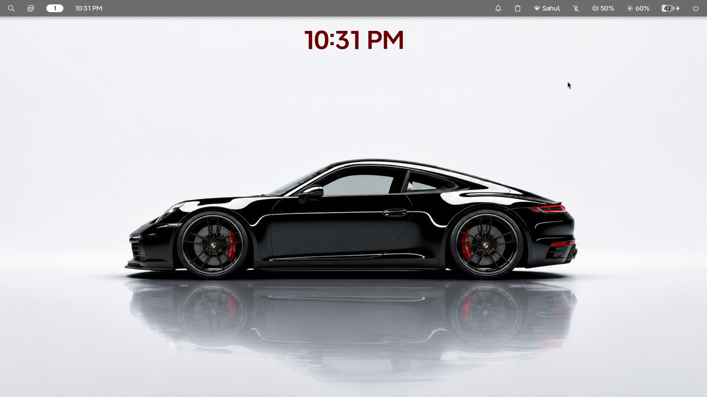
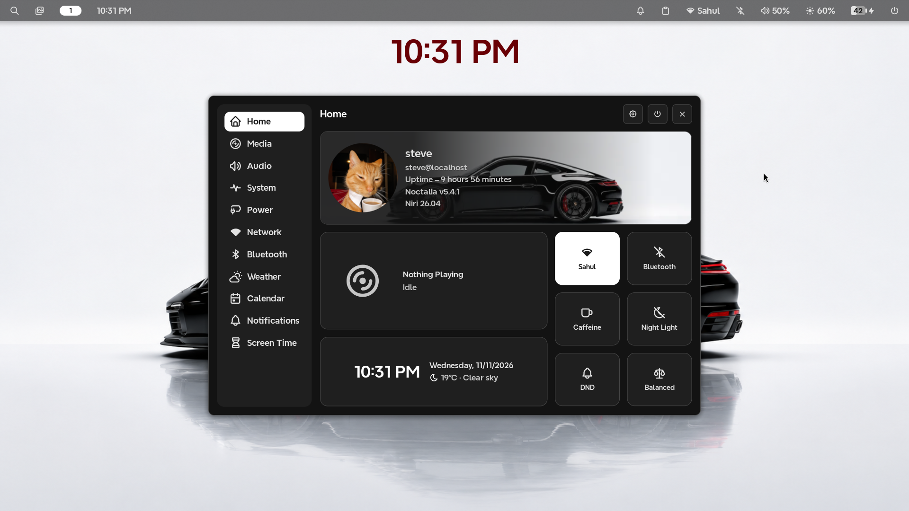
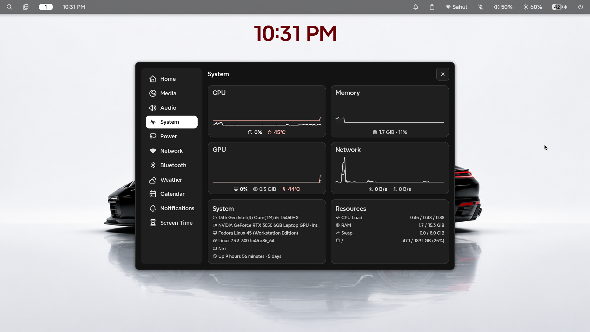
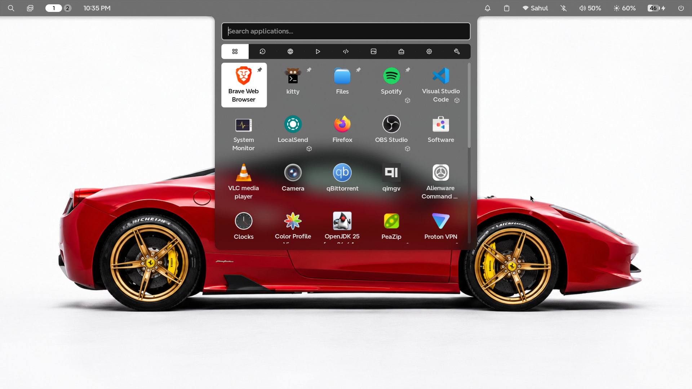
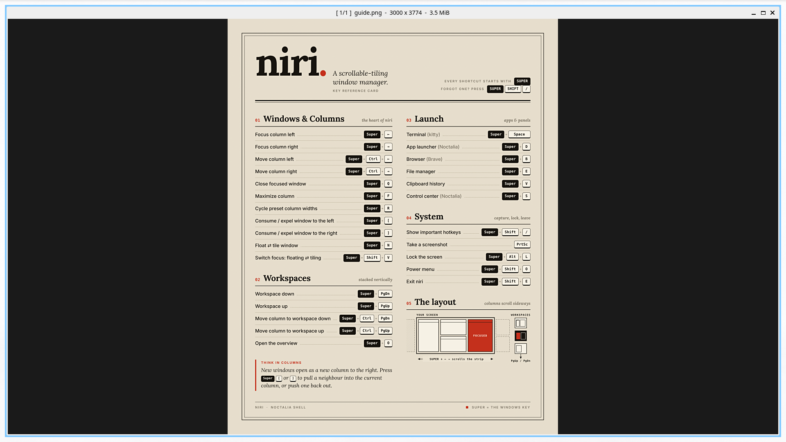
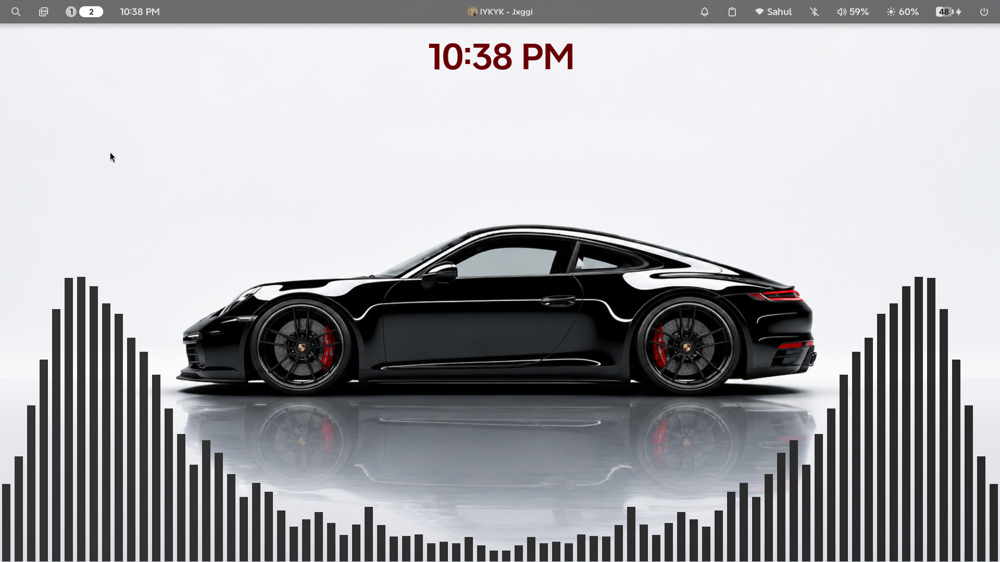

# Fedora Dotfiles

A collection of my personal Fedora Linux configurations, featuring **Niri** as the scrollable-tiling Wayland compositor and **Noctalia v5** as the desktop shell.

Built around a clean, minimal, and functional desktop experience.

---

## Desktop 
## shaul is








> Replace the image above with your own desktop screenshot. Put it inside an `assets/` directory.

## Environment

| Component | Details |
|---|---|
| OS | Fedora Linux |
| Window Manager | [Niri](https://github.com/niri-wm/niri) |
| Desktop Shell | [Noctalia v5](https://github.com/noctalia-dev/noctalia-shell) |
| Display Protocol | Wayland |
| Terminal | Kitty |
| GPU | NVIDIA GeForce RTX 3050 |
| Shell | Bash |

## Features

- Scrollable tiling window management with Niri.
- Noctalia v5 desktop shell and widgets.
- Custom keybindings and workspace management.
- Personalized terminal appearance.
- Minimal and consistent desktop styling.
- NVIDIA GPU support.

## Repository Structure

```text
.
├── niri/
│   └── config.kdl
├── noctalia/
│   └── ...
├── kitty/
│   └── kitty.conf
├── assets/
│   └── all screenshots
└── README.md
```

*The directory structure may vary depending on the configurations included in this repository.*

## Installation

**1. Clone the repository**

```bash
git clone https://github.com/YOUR_USERNAME/YOUR_REPOSITORY.git
cd YOUR_REPOSITORY
```

**2. Back up your existing configurations**

```bash
mkdir -p ~/.config-backup
cp -r ~/.config/niri ~/.config-backup/ 2>/dev/null
cp -r ~/.config/noctalia ~/.config-backup/ 2>/dev/null
```

**3. Copy the configurations**

Adapt the paths below to match your repository structure.

```bash
cp -r niri ~/.config/
cp -r noctalia ~/.config/
```

**4. Restart your session**

Log out and select Niri from your display manager to load the configuration.

## Dependencies

Make sure the following components are installed before applying these configurations:

- Fedora Linux
- Niri
- Noctalia Shell v5
- Kitty

Additional dependencies may be required depending on the configuration and enabled features.

## Notes

- These dotfiles reflect my personal desktop setup.
- Some configurations may require additional packages or adjustments.
- Always back up your existing configurations before replacing them.
- Feel free to fork, explore, and customize.

## Credits

- [Niri](https://github.com/niri-wm/niri) — Scrollable-tiling Wayland compositor.
- [Noctalia](https://github.com/noctalia-dev/noctalia-shell) — Desktop shell.
- [Kitty](https://github.com/kovidgoyal/kitty) — GPU-accelerated terminal emulator.

---

<p align="center">
  Made with care on Fedora Linux.
</p>